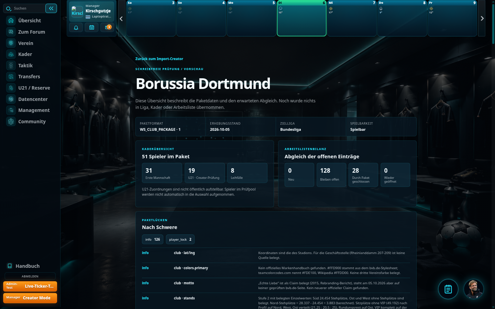
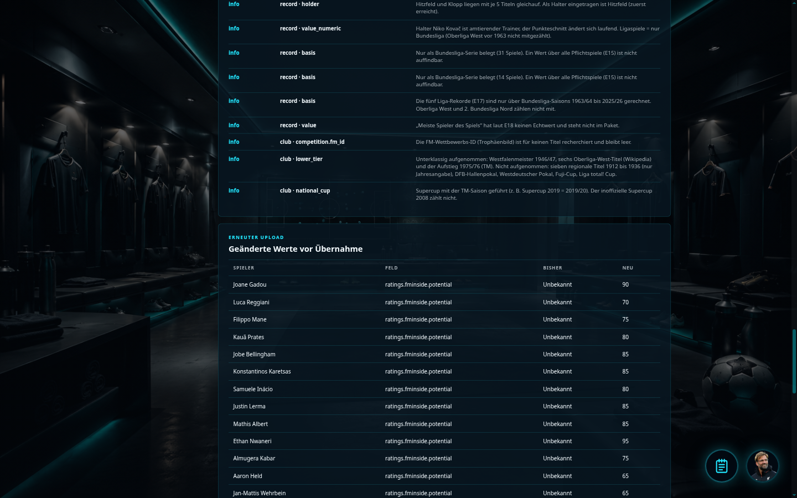
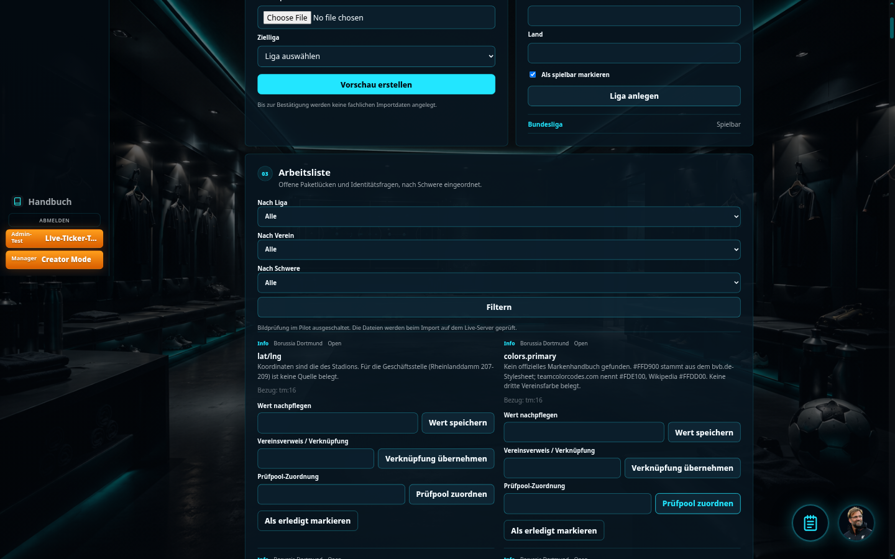

# T3/T4 – Abschluss nach Nachtrag 11

Stand: 6. Oktober 2026. Nachtrag 11 ersetzt den früheren Halt auf v1. Der vollständige Gesamtlauf ist grün, der v1-Pilot ist gesichert, und **v2 wurde über Vorschau und Bestätigung im echten Pilot eingelesen**. Alle fünf Sollzahlen stimmen. Danach keine weiteren Datenänderungen; die Kontrolle der vier BVB-Seiten liegt beim Nutzer.

## 1. Pilotadresse und Anmeldung

[Echten Import-Pilot öffnen](https://6e4eaecc-e6c5-4f64-8de5-e8845034f33b-00-sf51mfqyyw4m.janeway.replit.dev/import-pilot/)

Normale Anmeldung: `/import-pilot/auth/login/`. Bestehende kopierte Konten verwenden ihre normale Anmeldung. Creator-Aktionen sind serverseitig auf Staff/Superuser begrenzt. Für den Browsernachweis wurde nur eine kurzlebige Sitzung eines bestehenden berechtigten Kontos verwendet; keine Benutzer, Passwörter oder Rollen wurden geändert.

Creator-Upload und Arbeitsliste: `/import-pilot/creator/packages/`.

## 2. Echte Vorschau, Bestätigung und Arbeitsliste

Nach grünem Gesamtlauf und v1-Sicherung wurde die freigegebene v2-ZIP mit der vorhandenen Bundesliga hochgeladen. Die Vorschau meldete 28 Quellwertänderungen, 14 zusätzliche berechnete Stärken sowie die Abgleichbilanz **0 neu / 128 weiterhin offen / 28 durch Paket erledigt / 0 wieder offen**.

Die Bestätigung erfolgte einmal über den normalen Creator-Knopf. Anschließend meldete der echte Pilot „Paket bestätigt“. Die folgenden neuen Bildschirmfotos stammen aus diesem Pilot, nicht aus dem getrennten Testbestand.

Auch die Darstellung ist geprüft: 156 Artikel auf der Arbeitsliste, davon 28 mit dem Status „Durch neues Paket erledigt“. Eine anfängliche Browserprüfung suchte irrtümlich eine nicht vorhandene CSS-Klasse; die Prüfung wurde auf die tatsächlich gerenderten Statusfelder korrigiert und bestand ohne Code- oder Datenänderung.

Der Wiederholungsnachweis v1 → v2 → v2 gehört weiterhin zum getrennten Testbestand. Im echten Pilot wurde v2 nicht ein zweites Mal bestätigt.

## 3. Vorschau schreibt nichts

Der Gesamtlauf enthält den Vergleich vollständiger Tabellen-Fingerprints vor und nach der Vorschau sowie den unveränderten dritten Import im getrennten Bestand. Abbruch, manipulierte Bestätigungen, fremder Benutzer, CSRF und veralteter Datenstand sind geprüft.

Vor der echten Bestätigung blieb die Prüfsumme über die 156 Arbeitslistenzeilen — ID, Status und Text — unverändert:

`c5564c8a8d23a4e89e13286ba2efe78f0bddddb16fd1d6664fb48554b2c0187c`

Der Bestätigungstoken ist an Benutzer, Paket und geprüften Datenstand gebunden; auch die Einstellung zur Bildprüfung gehört nun zum geprüften Zustand. Es gibt keine temporäre Upload-/Entwurfszeile in der Datenbank.

## 4. Ligastart- und Einzelsperren

Die bereits gebauten Ligastartprüfungen bleiben aktiv: Saisoninitialisierung, zentrale Spielplanerzeugung, `play_matchday`, Model-Signale für Saisonstatus und Fixtures sowie Creator-/Admin-Bulk-Erzeugung vor Löschung oder Anlage. Offene sperrende Einträge verhindern den Start; Infoeinträge nicht. Die Prüfungen sind Bestandteil des grünen Gesamtlaufs.

N48 wurde nicht gelockert: ID `nicht_gefunden`, vorhandene FM-/CMTracker-ID ohne Rating oder keine berechnete Stärke sperren den Spieler. CMTracker `nicht_vorhanden` allein sperrt nicht; eine handergänzte ID ohne Rating hebt die Sperre nicht auf.

Die 16 Sperren bei einem frischen v1-Testimport sind nach N51 richtig: 14 fehlende Potenzialquellen sowie die beiden Gems. Der echte v1-Pilot wurde weder neu importiert noch zur Anpassung dieser Altstände verändert. Nach v2 bestehen genau die beiden vorgesehenen Sperren.

## 5. Bildprüfung nach N50

Einstellung: **`IMPORT_PACKAGE_IMAGE_CHECK_ENABLED`**.

| Konfiguration | Wert |
|---|---|
| Import-Pilot | **False** |
| Core-/spätere Live-Konfiguration | **True als Standard**, über gleichnamige Umgebungsvariable steuerbar |

Im Pilot erscheinen keine Dateizahlen in der Vorschau und kein ausführbarer Bildabgleich-Knopf. Ein direkter POST auf den ausgeschalteten Bildabgleich wird ohne fachliche Schreibzugriffe mit 403 abgelehnt. Auch vorhandene Bild-Infozeilen würden bei ausgeschalteter Prüfung nicht automatisch geschlossen oder umgeschrieben.

Die ursprüngliche Dateiprüfung bleibt erhalten und ist mit ein- und ausgeschaltetem Schalter getestet. Ihr früheres Replit-Ergebnis war: Wappen gefunden, 51 Spielerporträts und 11 Personenporträts lokal nicht vorhanden. Das beschreibt ausschließlich Replits Dateispeicher, **keinen Mangel des BVB-Bildbestands auf dem Live-Server**. Punkt 5 ist nach N50 erledigt und kein Pilot-Abnahmekriterium.

Fehlende Bilder sperren niemals. Hetzner wurde nicht aufgerufen; dort wurde weder eine Einstellung verändert noch ein Import durchgeführt.

## 6. Die vier bestehenden BVB-Seiten

Vereinsseite, Kader, Spielerprofil und Ruhmeshalle wurden zuvor im getrennten v2-Testbestand geprüft. Die folgenden Aufnahmen sind die vorhandenen T4-Nachweise aus diesem Testbestand; sie werden nicht als neue Aufnahmen des echten Pilots ausgegeben.

- **Verein:** SIGNAL IDUNA PARK, nationale Kapazität 81.365 und alle zwölf Steh-/Sitz-/VIP-Quellenwerte.
- **Kader:** erste Mannschaft und getrennter Leihpool. U21 nur für Creator; ein Test mit vorhandenem U21-Spieler bestätigt das Verbergen für normale Benutzer.
- **Spielerprofil:** vollständiger Marktwertgraph, gekennzeichneter Spiel-Startwert und Transfers neueste zuerst; fremde Originalnamen ohne erfundene Wappen.
- **Ruhmeshalle:** echte Rekorde und 30 Titel-Einzeleinträge. Lesender Creator-Zugang ohne Managerzuweisung: `/import-pilot/management/halloffame/?club=8&raum=club&modus=echt`.

Diese Seiten können jetzt im echten v2-Pilot durch den Nutzer kontrolliert werden. Eine Live-Ausrollung ist noch nicht erfolgt.

## 7. Schalter und neue Stellen

`IMPORT_PACKAGE_MODE` bleibt der einzige temporäre Verhaltensschalter für den Neuaufbau; das gemeinsame Schema ist unverändert und kennt keinen zweiten Schema-Schalter.

N50 ergänzt unabhängig davon die Dateiprüfungs-Einstellung. Sie greift in `package_preview.py`, `issue_lifecycle.py`, `package_views.py` und den beiden bestehenden Creator-Templates. Die Prüffunktion selbst bleibt für eingeschaltete Umgebungen verfügbar.

Für N52 liefern `runtime.py` sowie die bestehenden Ansichten in `views.py`, `views_creator.py` und `package_views.py` im Paketmodus sichtbare Vereins-/Liga-Listen ohne den technischen Karriereende-Status. Das umfasst Auswahl-/Filterlisten, Creator-Länder/Ligen, Vereinszählungen, Gesamtbudget und Vereinsrankings. Technische ORM-Zugriffe bleiben unverändert; im Altmodus liefern die Helfer weiterhin die bisherigen vollständigen Querysets.

Keine neue Migration, kein Schema-Drift; `makemigrations --check --dry-run` und `git diff --check` sind unauffällig.

## 8. Grüner Gesamtlauf und Herkunft des Scheinvereins

**1.668 von 1.668 Tests bestanden, 425,054 Sekunden, Exit-Code 0.**

Kommando: `python manage.py test game.tests --verbosity=0 --keepdb`.

Der tatsächliche Testumfang ist inzwischen um zehn Prüfungen größer als die 1.658 aus dem früheren Bericht. Keine Prüfung wurde entfernt, um die alte Zahl zu erreichen. Der neue Mengentest zählt jetzt explizit nur Club-Zeilen mit angewendetem `club_package`-Import, nicht alle technischen Club-Zeilen.

**Herkunft:** Migration `0009_alter_player_position_alter_player_primary_position_and_more`, Funktion `normalize_positions_and_create_career_end`, legt den Verein **„Karrierende“** in der Systemliga **„Sonderstatus“** an. Er dient als technisches Ziel für ausgeschiedene Spieler, unter anderem beim idempotenten Karriereende-/Abfindungspfad; er ist kein importierter Verweisverein.

**Nachweis:** Ein Test mit vorhandener Systemliga und vorhandenem Systemverein prüft sichtbare Vereins-/Liga-Querysets, Vereinsübersicht, Creator-Länder-/Vereinszählung und Paket-Creator. Dort erscheinen beide im Paketmodus nicht. Derselbe Test bestätigt den unveränderten technischen Zugriff im Altmodus. Der echte Pilot enthält tatsächlich **keine** „Karrierende“-Club-Zeile, nur einen importierten Verein und eine sichtbare Liga.

Metadaten des Gesamtlaufs und der getrennten Importfolge: `docs/import-pilot/n11-test-result.json`.

## 9. V1-Dump und Soll/Ist nach v2

Die Sicherung wurde erst nach dem grünen Gesamtlauf erstellt und vor der echten Vorschau/Bestätigung:

| Sicherung | Wert |
|---|---|
| Dateiname | `bvb-v1-20261006T124120Z.dump` |
| Ablage | `backups/import-pilot/bvb-v1-20261006T124120Z.dump` |
| Größe | **1.029.187 Bytes** |
| Format | PostgreSQL Custom Archive |
| Umfang | ausschließlich Schema `import_pilot` |
| Dateirechte | 0600 |
| SHA-256 | `0fc545cf8cd9e9405f864719ca799966268b0856d88343b70aa7b1d3eeea4b67` |

`pg_restore --list` bestätigt ein lesbares Archiv ohne `public`-Tabellendaten. Es wurde ein exportierter PostgreSQL-Snapshot verwendet; der begleitende v1-Fingerprint stammt aus derselben konsistenten Sicht. Der Dump ist privat und gitignoriert, enthält Konten-/Sitzungsdaten und wird deshalb nicht als öffentliche Berichtsdatei bereitgestellt. Er bleibt liegen. **Kein Restore oder Reset wurde ausgeführt.**

V1 unmittelbar vor Sicherung: 156 offene Zeilen, Status-/Texthash unverändert, 35 gespeicherte Stärken und zwei bestehende Sperren. V1-Paket-Hash:

`9d2b87c16389caf12693da07d7644df2c5f7d36e1e8c979b8651ead1e951676d`

Nach genau einem bestätigten v2-Import:

| Größe | Soll | Ist |
|---|---:|---:|
| Arbeitslistenzeilen | 156 | **156** |
| Offen | 128 | **128** |
| Durch Paket erledigt | 28 | **28** |
| Berechnete Stärken | 49 | **49** |
| Einzelsperren | 2 | **2** |

Gesperrt sind exakt **Takato Yamamoto und Bjarki Gardarsson**. Die Spielerzählung berücksichtigt alle 51 Paketspieler einschließlich der Leihspieler, nicht nur `owner_club`.

V2-Paket-Hash:

`ab3925f40f1b84ddd103a25928d61aa7feb3c36d9036890ff802131896751391`

Die getrennte echte Import-/Stärkepipeline bestätigt weiterhin 51 Spieler, 132 Quellstände, 637 Marktwertpunkte, 322 Transfers, 24 Rekorde, 30 Titel sowie zeilengleiche Wiederholung von v2. Rohskalen-Stichproben Basis/Potenzial: Nwaneri 145/181, Inácio 120/166, Reggiani 116/152, Fahrenhorst 90/160, Wüstenhagen 92/100. Keine Stärkeformel wurde geändert.

Fingerprints und Dump-Metadaten: `n11-v1-before.json`, `n11-v1-dump.json` und `n11-v2-after.json` unter `docs/import-pilot/`. Die öffentliche Arbeitsliste bleibt bei null Zeilen.

## 10. Arbeitslisten-Lebenszyklus und Abschluss

N47 bleibt unverändert: Verein + Gegenstandsart + Bezug + Feld; im Mehrfachfall ein Unterschlüssel aus dem exakten Text. Einzeltextänderungen erhalten die Zeile; bei Einzel↔Mehrfach führt der gleiche Text weiter. Wegfall schließt durch Paket, Wiederkehr öffnet erneut. Handeinträge und Handabschluss bleiben unterscheidbar; fehlende Paketwerte übernehmen Handwerte, abweichende gelieferte Paketwerte gewinnen nach Vorschau.

Die bestehenden 156 Pilotzeilen wurden durch Migration 0190 ursprünglich in Anzahl, Status und Text erhalten; zehn haben einen Unter-Schlüssel. Jetzt wurden ausschließlich die vorgesehenen 28 Einträge durch v2 geschlossen. N48 wird weiterhin aus den tatsächlichen Daten abgeleitet und nicht per Handabschluss umgangen.

**N50–N53 erfüllt. Jetzt Nutzerkontrolle des BVB im echten v2-Pilot.** Kein T5/Reset, kein Dortmund-Szenenbackup, kein Hetznerzugriff, kein Publishing und keine Änderung an der Stärkeformel. Keine weiteren Imports oder Änderungen an Arbeitslistenzeilen.
