# T3/T4 – Abschlussnachweis

Stand: 6. Oktober 2026. Umsetzung nach dem freigegebenen Entwurf und Nachträgen 8–10. **Der echte Pilot bleibt auf BVB v1.** Die Importfolge v1 → v2 → v2 wurde ausschließlich in getrennten Testdatenbanken durchgeführt.

## 1. Pilotadresse und Anmeldung

[Import-Pilot öffnen](https://6e4eaecc-e6c5-4f64-8de5-e8845034f33b-00-sf51mfqyyw4m.janeway.replit.dev/import-pilot/)

Die normale Anmeldung liegt unter `/import-pilot/auth/login/`. Bestehende kopierte Konten verwenden ihre normale Anmeldung; es gibt keinen produktiven Test-Login oder Rechte-Bypass. Creator-Zugriff erfordert Staff-/Superuser-Rechte, serverseitig geprüft.

Der Paket-Creator liegt unter `/import-pilot/creator/packages/`. Vereins- und Spieleransichten verwenden die bestehenden Seiten unter demselben Pilotpräfix. Die Ruhmeshalle lässt sich als Creator ohne Managerzuweisung lesend über `/import-pilot/management/halloffame/?club=1&raum=club&modus=echt` ansehen.

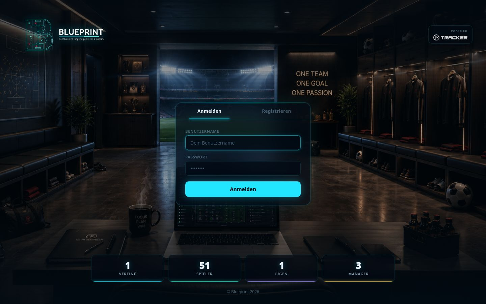

## 2. Upload, Vorschau, Bestätigung und Arbeitsliste

Upload mit Zielliga, schreibfreie Vorschau, ausdrückliche Bestätigung und vereinsgebundene Arbeitsliste sind umgesetzt. Die Arbeitsliste bietet Status-/Schwerefilter, Handeinträge, datenabhängige Sperren und einen eigenen Bildabgleich.

Der Browserdurchlauf erfolgte ausschließlich im getrennten Testbestand: v2 zeigte 28 Wertänderungen, 14 zusätzliche berechnete Stärken und die Bilanz **0 neu / 128 weiterhin offen / 28 durch Paket erledigt / 0 wieder offen**. Abbruch, erneutes Öffnen und Bestätigung funktionierten. Danach standen 128 Einträge offen und 28 auf „Durch neues Paket erledigt“. Dieselbe ZIP erneut bestätigt meldete „Unverändert“ und behielt diese Werte.

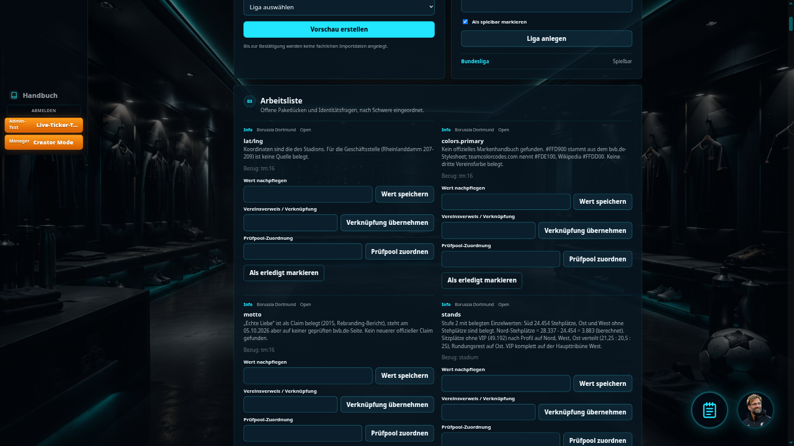
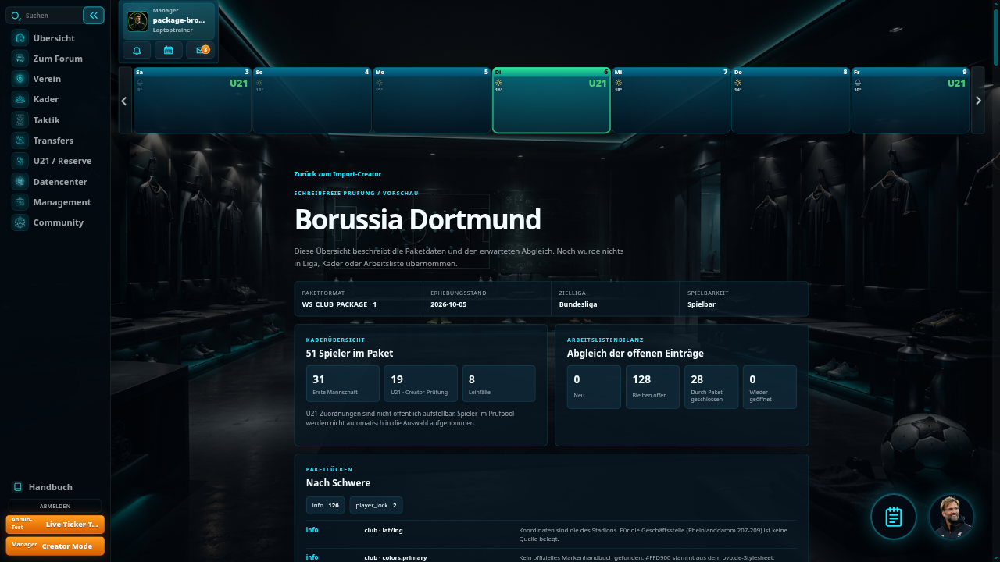
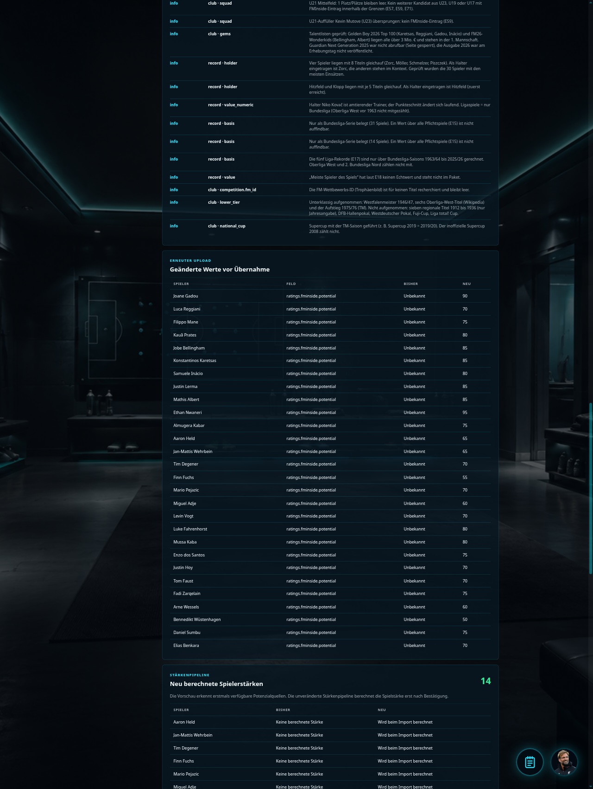
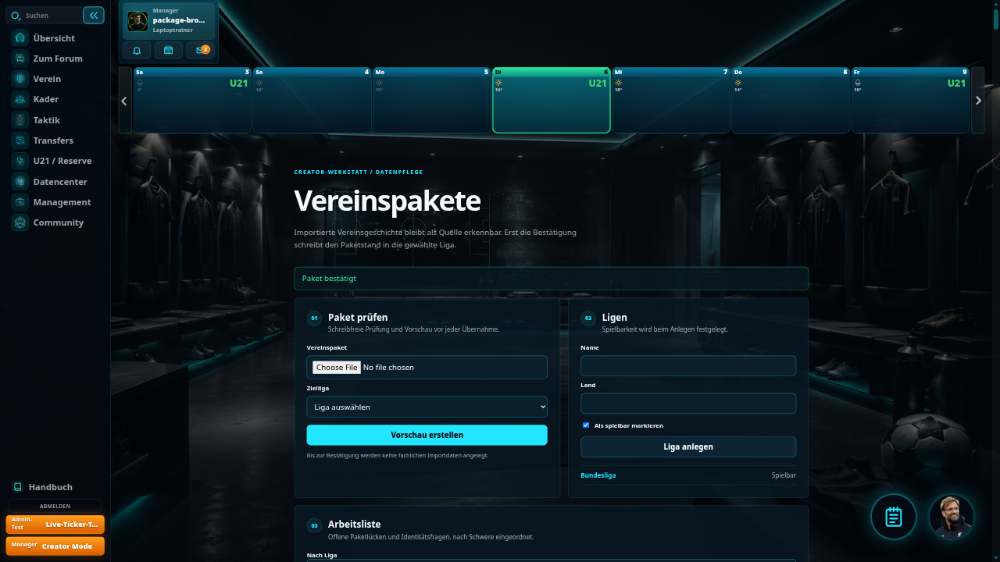

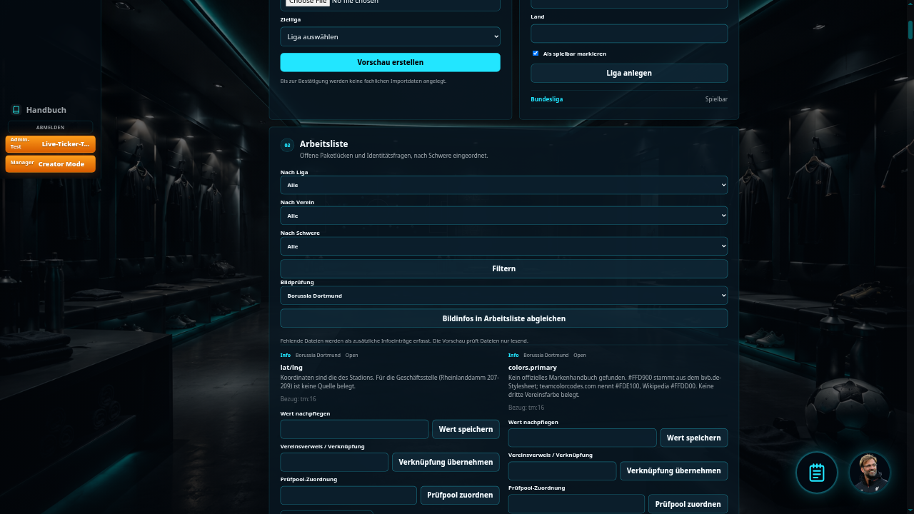

## 3. Schreibfreie Vorschau und rückstandsfreier Abbruch

Der gezielte Test vergleicht vollständige Tabelleninhalte vor und nach der Vorschau, nicht nur Anzahlen. Die Vorschau bleibt unverändert; sie legt keine Upload-, Entwurfs-, Quellstand- oder Arbeitslistenzeilen an. Der bestätigungsfähige Paketinhalt liegt signiert auf der Clientseite, nicht als temporärer Datenbank-Upload.

Bestätigungen sind an Benutzer, Paket und geprüften Datenstand gebunden. Manipulierte Inhalte, ein anderer Benutzer und nachträglich veränderte Arbeitslisten-/Liga-/Paketstände werden abgewiesen. CSRF ist aktiv. Ein fehlender CSRF-Nachweis wird abgelehnt.

Im Browser wurde die Vorschau verlassen, ohne zu bestätigen, anschließend erneut geöffnet und erst dann bestätigt. Die Datenbankgleichheit wird durch die automatisierte Prüfung belegt; der Browserdurchlauf allein wurde ausdrücklich nicht als Hash-Nachweis gewertet.

## 4. Ligastartwege und Sperren

Offene Einträge mit Schwere `blocking` verhindern den Ligastart. Infoeinträge sperren nicht. Die gemeinsame Prüfung ist an diesen Wegen eingebunden:

- zentrale Saisoninitialisierung und zentrale Saison-Spielplanerzeugung;
- Management-Command `play_matchday`;
- Speichern von `LeagueSeasonState`;
- Speichern einzelner `SeasonFixture`-Zeilen;
- Creator-Spielplanerzeugung vor Löschung oder Bulk-Anlage;
- Admin-Spielplanerzeugung vor Löschung oder Bulk-Anlage.

Gezielte Tests prüfen die Service-/Modelpfade sowie Creator- und Admin-Aufrufe. Die beiden Bulk-Wege brechen mit einer verständlichen Meldung und Weiterleitung ab; die Zahl der Spielplanzeilen bleibt unverändert. Der Model-Signalweg allein wurde nicht als ausreichend für `bulk_create` behandelt.

Einzelne Spieler werden unabhängig davon nach N48 gesperrt: FM/TM/CMTRACKER `nicht_gefunden`, vorhandene FM-/CMTRACKER-ID ohne entsprechendes Rating oder keine berechnete Stärke. `CMTRACKER nicht_vorhanden` allein sperrt nicht. Handergänzte IDs ohne Rating heben die Sperre nicht auf. Spieler-Sperren können nicht von Hand abgehakt werden.

## 5. Fehlende Bilder beim BVB

Die Dateiprüfung fand **62 fehlende Dateien**:

| Art | Fehlend |
|---|---:|
| Vereinswappen | 0 |
| Spielerporträts | 51 |
| Historische Personenporträts | 11 |

Diese Prüfung erfindet keine Bilder oder Vereinszuordnungen. Fehlende Wappen werden im Pilot ohne Serverfehler beziehungsweise mit transparenter Darstellung/Leerzustand behandelt; historische Fremdvereine erscheinen mit ihrem Namen und „ohne Wappen“.

**Wichtige Abgrenzung:** Die Vorschau zeigt die 62 Dateihinweise nur lesend. Der explizite Button „Bildinfos in Arbeitsliste abgleichen“ schreibt zusätzliche Infoeinträge. Nach Aktivierung werden diese bei späteren Uploads automatisch mitgeführt, geschlossen und bei erneuter Lücke wieder geöffnet. Die geforderten 156 Paketzeilen und die folgenden Messwerte beziehen sich auf den Zustand **vor diesem optionalen Dateiabgleich**. Der Button wurde im Kontrolllauf bewusst nicht betätigt. Der Bild-Lebenszyklus und der transparente Fehlwappen-Endpunkt sind separat getestet.

## 6. Vier bestehende Seiten

Die folgenden Aufnahmen stammen aus dem getrennten Testbestand, **nicht aus einem v2-Import in den echten Pilot**.

**Verein:** SIGNAL IDUNA PARK, alle zwölf Steh-/Sitz-/VIP-Werte mit `berechnet`/`belegt`. Die nationale Kapazität 81.365 wird aus dem importierten Stadion gelesen und wurde per Seiteninhalt und Test-Client bestätigt; die normale Kapazitätskarte liegt unterhalb des gezeigten Ausschnitts.

| Seite | Stehen | Sitzen | VIP |
|---|---:|---:|---:|
| Nord | 3.883 | 15.660 | 0 |
| Ost | 0 | 18.425 | 0 |
| Süd | 24.454 | 0 | 0 |
| West | 0 | 15.107 | 3.836 |

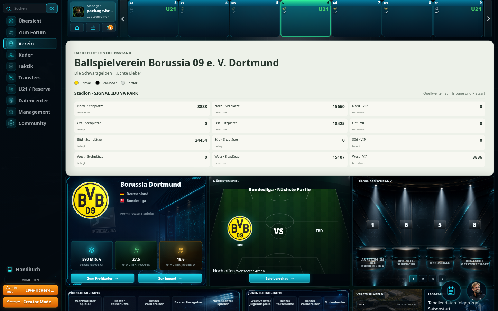

**Kader:** erste Mannschaft, eigener Leihpool und ausschließlich für Creator sichtbare U21-Prüfung. Im Leihpool: Elias Benkara, Yan Couto, Almugera Kabar und Diant Ramaj. Die U21 ist nicht für Aufstellungen verfügbar. Ein gesonderter Test mit einem normalen Benutzer und einem tatsächlich vorhandenen U21-Spieler bestätigt, dass weder Abschnitt noch Spielername öffentlich erscheinen.

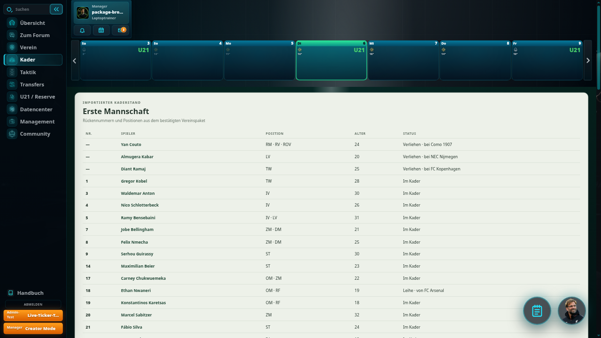
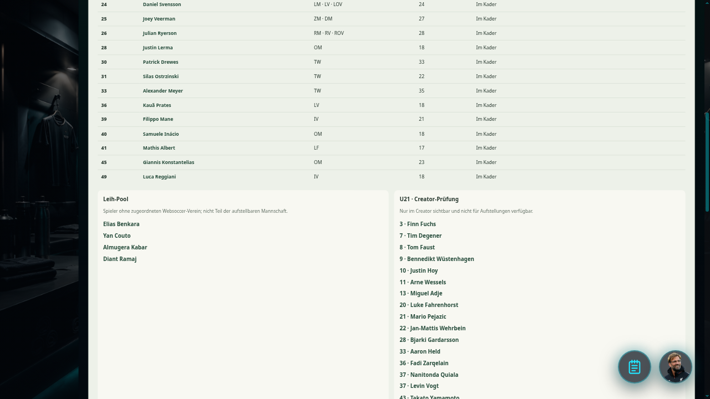

**Spieler:** Ethan Nwaneri, neun Marktwertpunkte und sechs Transfers, neueste zuerst. Der 50.000-€-Startwert wird als Spielwert statt als recherchierter Quellwert erläutert. Fremdvereinsnamen bleiben erhalten; fehlende Wappen werden nicht erfunden.

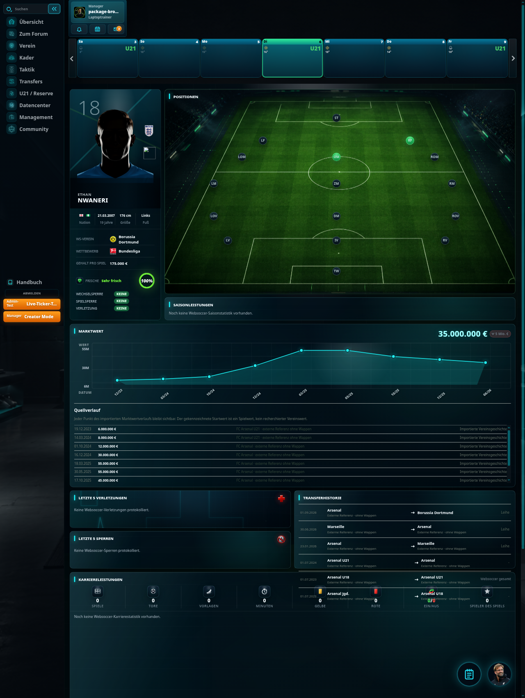

**Ruhmeshalle:** bestehender echter Vereinsraum mit 30 einzelnen Titeln. Der lesende Creator-Aufruf per `club` ist separat getestet und verändert keine Managerzuweisung.

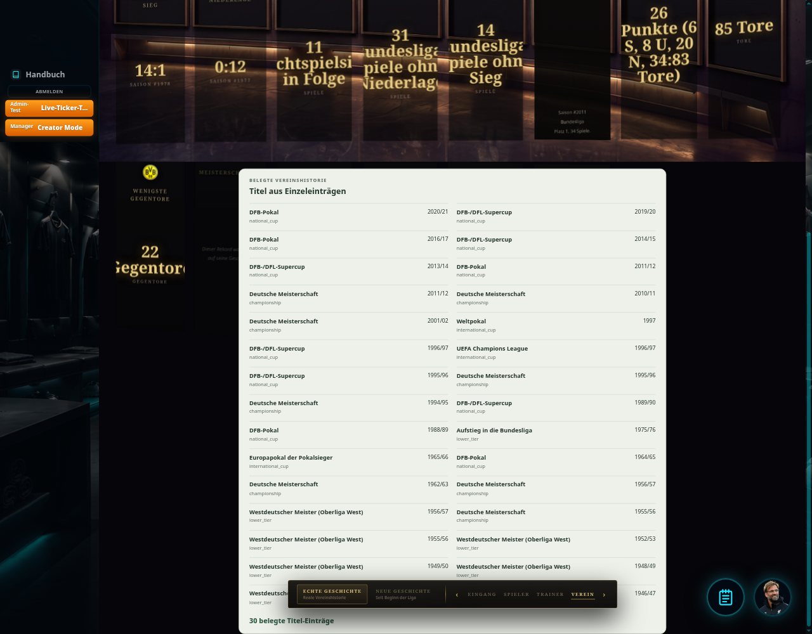

## 7. Verhaltensschalter

Es bleibt ein zentraler temporärer Verhaltensschalter: `IMPORT_PACKAGE_MODE`. `core/settings.py` bleibt im Altmodus, `import_pilot/settings.py` schaltet den Pilot ein. Das gemeinsame Schema ist in beiden Modi vorhanden; es gibt keinen zweiten Schema-Schalter.

Neue beziehungsweise ergänzte verhaltensabhängige Stellen:

- `game/club_import/package_views.py`: Creator-Routen, Rollen und Bestätigung;
- `game/club_import/package_service.py`: freigegebene Paketprojektion;
- `game/club_import/league_guard.py`: gemeinsame Ligastartprüfung und Model-Signale;
- `game/season_service.py`, `game/management/commands/play_matchday.py`, `game/admin.py`, `game/views_creator.py`: Aufruf dieser Prüfung;
- `game/views.py`: bestehende Vereins-, Kader-/U21- und Spieleransichten;
- `game/views_management.py`: bestehende Ruhmeshalle und lesende Creator-Auswahl;
- `game/club_import/runtime.py`: gemeinsame Besitzer-, Scouting-, Aufstellungs- und Prüfpool-Regeln.

`issue_lifecycle.py` und `package_preview.py` gehören ausschließlich zur Paketstrecke. `core/package_test_settings.py` ist nur der getrennte Testserver. `/import-pilot/` ist ein Entwicklungsproxy; er ist kein Produktionswechsel.

## 8. Altmodus-Testergebnis

Der Gesamtlauf hatte **1.658 Tests in 428 Sekunden**. **Alle 1.657 bestehenden Tests bestanden.** Der einzige Fehler lag im neuen Paket-Sequenztest: Er zählte einen durch Migrationen bereits vorhandenen Systemverein mit und erwartete deshalb fälschlich insgesamt eine statt zwei Club-Zeilen. Die Prüfung wurde auf zusätzlich importierte Vereine gegenüber dem Ausgangsbestand korrigiert.

Dieser korrigierte Sequenztest und sämtliche neuen Fälle bestanden im abschließenden, zusammenhängenden Lauf: **14 Tests, 42,710 Sekunden, OK**. Der siebenminütige Gesamtlauf wurde nicht nochmals wiederholt. `manage.py check`, `makemigrations --check --dry-run` und `git diff --check` sind unauffällig.

Ein bereits vorhandener Fehler bei fehlenden statischen Bilddateien in der normalen Entwicklungsvorschau wurde separat vorgeschlagen, nicht im eingefrorenen Altmodus behoben. Er ist kein bestandenes Teilresultat dieses Auftrags.

## 9. Messwerte, Stichproben und unveränderter Pilot

Die echte Import-/Stärkepipeline wurde in getrennten SQLite- und Django-Testbeständen geprüft. Vollständige Tabellen-Fingerprints bestätigen: Die Vorschau schreibt nicht, und die dritte Übernahme desselben v2 lässt den Bestand unverändert.

| Größe | Frischer v1-Testimport | v2-Testimport |
|---|---:|---:|
| Spieler | 51 | 51 |
| Berechnete Stärke | 35 | 49 |
| Einzelsperren nach N48 | **16** | 2 |
| Quellstand-Archiv | 83 | 132 |
| Marktwertpunkte | 637 | 637 |
| Transfers | 322 | 322 |
| Rekorde | 24 | 24 |
| Titel-Einzeleinträge | 30 | 30 |
| Arbeitslistenzeilen | 156 | 156 |
| Offen | 156 | 128 |
| Durch Paket erledigt | 0 | 28 |
| Zusätzlich importierte Club-Zeilen | 1 | 1 |

**Abweichung zum früheren v1-Sollwert 2:** N48 sperrt zusätzlich die 14 Spieler ohne berechnete Stärke. Deshalb ergeben sich beim frischen v1-Import 16 statt 2 Sperren. v2 ergänzt die fehlenden Potenziale, berechnet diese 14 Stärken und reduziert die Sperren auf 2. Die Stärkeformel wurde nicht angepasst, um einen Sollwert zu erzwingen.

Die geforderten Stichproben beziehen sich auf die gemeinsamen rohen 0–200-Basis-/Potenzialwerte, nicht auf den anschließend positions-/profilgewichteten Maximalwert:

| Spieler | Basis | Potenzial |
|---|---:|---:|
| Ethan Nwaneri | 145 | 181 |
| Samuele Inácio | 120 | 166 |
| Luca Reggiani | 116 | 152 |
| Luke Fahrenhorst | 90 | 160 |
| Bennedikt Wüstenhagen | 92 | 100 |

**Echter Pilot weiterhin v1:**

- angewendeter Paket-Hash: `9d2b87c16389caf12693da07d7644df2c5f7d36e1e8c979b8651ead1e951676d`;
- 156 Arbeitslistenzeilen;
- unveränderter SHA-256 über ID, Status und Text: `c5564c8a8d23a4e89e13286ba2efe78f0bddddb16fd1d6664fb48554b2c0187c`;
- zehn nichtleere Unter-Schlüssel;
- Migration `0190_import_issue_lifecycle` im Pilot ausdrücklich als angewendet nachgewiesen;
- im öffentlichen Bestand weiterhin null Arbeitslistenzeilen.

Die additive Migration erweitert die Arbeitsliste, verändert aber die bisherigen Status und Texte nicht. Sie wurde für beide Schemata angewendet. Ein zwischenzeitlich fehlender Pilot-Migrationsmarker wurde erneut angewendet und anschließend unabhängig nachkontrolliert; eine Ursache dafür wird nicht behauptet.

## 10. Schlüssel, Wiederkehr und Handeinträge

Der Hauptschlüssel besteht aus Verein, Gegenstandsart, Gegenstandsbezug und Feld. Eine Einzel-Lücke verwendet einen leeren Unter-Schlüssel: geänderter Text oder geänderte Schwere erzeugen keine neue Zeile. Mehrere Lücken zum selben Hauptschlüssel erhalten einen SHA-256-Unter-Schlüssel des exakten Textes.

Geprüft wurden Textänderung, Einzel→Mehrfach, Mehrfach→Einzel, unveränderte gleichtextige Zeile und erhaltene Historie. Wegfall schließt durch Paket; Wiederkehr öffnet diesen Eintrag erneut. Handerledigte Zeilen bleiben erhalten. Die Vorschau zählt nur wirklich weiterhin offene Einträge als „weiterhin offen“.

Handwerte füllen fehlende Paketwerte. Gleiche gelieferte Werte erzeugen keinen Konflikt; abweichende Paketwerte gewinnen und werden vorher mit Alt-/Neuwert gezeigt. Ein veralteter Hand-Override wird danach beendet. Manuell ergänzte Fremdvereins-IDs und spätere Paketkorrekturen verändern die vorhandenen Marktwertereignisse, ohne zusätzliche Historienzeilen oder erfundene Club-Zeilen anzulegen.

Identitätskonflikte erscheinen in der Vergleichs-/Arbeitslistenstrecke, ohne automatische Zusammenführung. Ein gezielter Fall belegt, dass eine fremde FM-ID einen vorhandenen Spieler nicht auf eine andere TM-Identität umschreibt. Datenabhängige Spieler-Sperren bleiben dabei wirksam.

**Abschluss:** Kein T5, kein Reset, kein Dortmund-Backup, kein Zugriff auf Hetzner und keine Veröffentlichung. Keine Änderungen an `strength_engine.py` oder `strength_service.py`. Der zusätzliche Testserver wird beendet; nur Hauptanwendung und echter v1-Pilot bleiben aktiv. **Nach T3/T4 Halt.**
